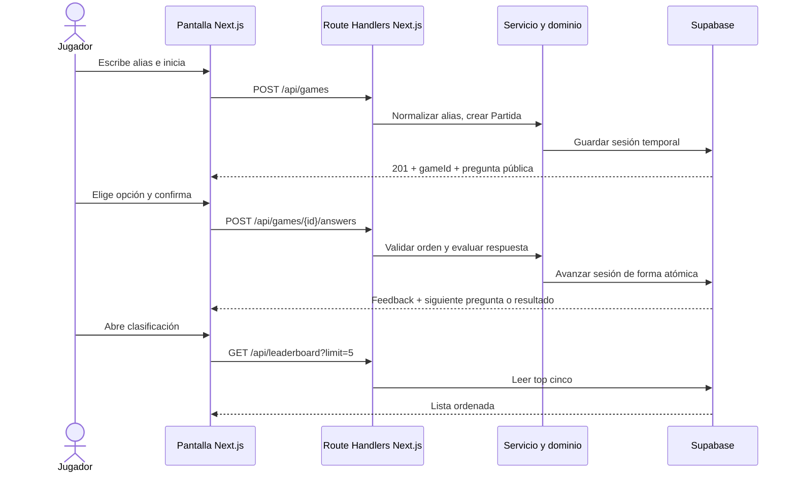

# Interfaces del frontend y llamadas a la API

## Alcance de interfaz

La guía del reto pide el recorrido de una trivia individual: iniciar con alias, responder diez preguntas de cuatro opciones, recibir confirmación de acierto/error, ver el resultado, consultar las cinco mejores partidas y volver a jugar. También pide teclado, mensajes claros y revisión en ventana estrecha. No pide cuentas, panel administrativo, editor de preguntas ni herramientas de gestión dentro del producto.

Por eso el sistema tendrá cuatro pantallas de usuario. La retroalimentación de respuesta es un estado de la pantalla de juego, no una quinta página. Las páginas usan Next.js App Router y el backend expone Route Handlers de Next.js sobre Node.js.

## Mapa de pantallas

| Pantalla | Ruta de frontend | Contenido y controles | Acción principal | API llamada |
|---|---|---|---|---|
| Inicio | `/` | Nombre/tema de la trivia, campo Alias, contador opcional “10 preguntas”, botón “Iniciar partida”. | Validar alias de 2–20 caracteres tras recortar espacios. Mostrar el error junto al campo. | `POST /api/games` |
| Partida | `/game/{gameId}` | Alias, “Pregunta N de 10”, enunciado, cuatro opciones como radios/botones, botón “Confirmar respuesta”. | Exigir selección, enviar una respuesta y bloquear controles mientras llega la respuesta. | `GET /api/games/{gameId}` al abrir/recargar; `POST /api/games/{gameId}/answers` al confirmar. |
| Resultado | `/result/{gameId}` | Alias, aciertos, errores y puntaje sobre 100. Confirmación de guardado. Botones “Ver clasificación”, “Jugar de nuevo” y “Cambiar alias”. | Mostrar el resultado devuelto por la última respuesta. Consultar clasificación solo cuando se abre esa vista. | `GET /api/games/{gameId}` si se recarga; `GET /api/leaderboard?limit=5` al elegir “Ver clasificación”; `POST /api/games` para otra partida. |
| Clasificación | `/leaderboard` | Hasta cinco filas: posición, alias, aciertos, errores, puntaje y fecha; estado vacío si no hay resultados. Botones “Jugar de nuevo” y “Volver al inicio”. | Consultar y representar el ranking en el orden recibido. | `GET /api/leaderboard?limit=5`; `POST /api/games` para jugar de nuevo con alias actual. |

### Estado de retroalimentación en la partida

Después de confirmar, la misma pantalla conserva la pregunta contestada, deshabilita sus opciones y muestra “Correcto” o “Incorrecto”. Para una respuesta incorrecta puede resaltar la opción correcta, que el backend incluye solo después de aceptar la respuesta. Un botón “Continuar” muestra la pregunta siguiente que ya vino en la respuesta de API; no hace una segunda llamada. En la décima respuesta, “Continuar” lleva al resultado.

La interfaz deshabilita “Confirmar respuesta” mientras la llamada está pendiente y después de aceptarse. El backend también bloquea una segunda puntuación, así que un doble clic o reintento de red no duplica el resultado.

## Contrato de cada interacción

### Inicio → crear partida

1. El usuario escribe un alias y pulsa **Iniciar partida**.
2. El cliente envía `{ "alias": "Luna" }` a `POST /api/games`.
3. Con `201`, conserva `gameId` en la URL y muestra la `question` y `progress` recibidas.
4. Con `400 INVALID_ALIAS`, permanece en inicio, enfoca el campo y presenta el mensaje de validación. Con `503 STORAGE_UNAVAILABLE`, ofrece reintentar sin afirmar que inició.

### Partida → confirmar respuesta

1. La selección de una opción es local; por sí sola no llama a la API.
2. El usuario confirma. El cliente envía `{ "questionId": "q-01", "selectedOptionId": "C" }` a `POST /api/games/{gameId}/answers`.
3. Con respuesta `IN_PROGRESS`, muestra la retroalimentación y guarda en estado de pantalla `nextQuestion` hasta que el usuario pulse **Continuar**.
4. Con respuesta `COMPLETED`, muestra la retroalimentación de la décima pregunta y conserva `result`; al continuar abre Resultado.
5. En errores `409`, `410` o `503`, muestra el mensaje del contrato y ofrece recuperar la partida o reintentar según el código. No incrementa el puntaje en el cliente.

### Resultado → clasificación / replay

- Resultado obtiene el resumen de la décima respuesta. Si la página se recarga, usa `GET /api/games/{gameId}` y recibe el resultado persistido.
- **Ver clasificación** navega a `/leaderboard`, que llama a `GET /api/leaderboard?limit=5`.
- **Jugar de nuevo** con el mismo alias vuelve a llamar `POST /api/games` con ese alias.
- **Cambiar alias** vuelve a Inicio y deja que el usuario introduzca otro alias. Los resultados previos no se borran.

### Clasificación

- En carga se muestra un indicador y se evita mostrar una lista antigua como si fuera actual.
- `200` con `items: []` presenta un mensaje de historial vacío y botón para jugar.
- `200` con resultados muestra exactamente el orden enviado por la API; los empates ya vienen resueltos por orden de registro.
- Ante error de lectura se conserva la opción de reintentar y no se muestra “sin partidas” como si fuera un resultado válido.

## Orden de llamadas



## Estados que debe diseñar Jordan

| Estado | Tratamiento visible |
|---|---|
| `loading` | Indicador y botón temporalmente deshabilitado; evitar dobles envíos. |
| `validation_error` | Mensaje asociado al alias o a la selección faltante; mantener el valor que el usuario escribió. |
| `in_progress` | Pregunta vigente, avance visible y opción seleccionada. |
| `feedback` | Respuesta bloqueada, acierto/error y botón **Continuar**. |
| `completed` | Resultado persistido, resumen de aciertos/errores/puntaje y opciones siguientes. |
| `leaderboard_empty` | Explicación breve de que aún no hay partidas y acción para empezar. |
| `api_error` | Mensaje claro con reintentar; no simular éxito ni convertir un fallo en ranking vacío. |

## Reglas visuales y teclado

- Usar etiquetas visibles para el campo de alias y agrupar las cuatro opciones con un nombre accesible.
- Permitir Tab/Shift+Tab, selección por teclado y activación con Enter/Espacio; mantener foco visible.
- Tras error de validación, mover el foco al campo/opciones que requieren corrección.
- Tras feedback, anunciar el resultado con una región accesible (`aria-live`) y enfocar **Continuar**.
- Revisar la pantalla en una ventana estrecha, sin scroll horizontal ni controles cortados.
- Evitar depender solo del color para indicar respuesta correcta o incorrecta.

## Responsabilidad por módulo

- Jordan: estructura visual, estados anteriores, navegación con teclado y viewport estrecho; conectar los controles usando un cliente API sin lógica de puntuación.
- Cristian: contratos HTTP, validación de entradas y dominio; el servidor determina acierto y puntaje.
- Daniel: persistencia, clasificación y orden de resultados.
- Todos: revisar el flujo completo contra RF1–RF7 y los escenarios P1–P7 antes de cerrar las issues.

## Contexto de integración backend para Jordan

### Estado actual

El backend de la rama del [PR #16](https://github.com/pro158127/proyecto-final-lenguajes-quiz/pull/16) ya tiene los Route Handlers, dominio, repositorio Supabase y contrato HTTP. La interfaz de `app/page.js` todavía es una portada provisional; estas instrucciones son el handoff para implementar el frontend.

Rutas implementadas:

- `app/api/games/route.js`: crea una partida.
- `app/api/games/[gameId]/route.js`: recupera la sesión y el resumen final.
- `app/api/games/[gameId]/answers/route.js`: confirma una opción y devuelve feedback/avance.
- `app/api/leaderboard/route.js`: devuelve la clasificación.

No importes `src/server/*` desde componentes cliente y no inicialices Supabase en el navegador. El frontend usa `fetch` al mismo origen (`/api/...`). `SUPABASE_SERVICE_ROLE_KEY` es solo del backend y nunca debe tener prefijo `NEXT_PUBLIC_`.

### Datos que debe enviar el cliente

| Acción | Método/ruta | Body exacto |
|---|---|---|
| Iniciar/replay | `POST /api/games` | `{ "alias": "Luna" }` |
| Confirmar respuesta | `POST /api/games/{gameId}/answers` | `{ "questionId": "q-01", "selectedOptionId": "C" }` |
| Recuperar partida | `GET /api/games/{gameId}` | Sin body |
| Clasificación | `GET /api/leaderboard?limit=5` | Sin body |

`gameId` es el UUID que devuelve la creación. `questionId` es `q-01` a `q-10` por posición de partida, aunque el banco fuente tenga IDs distintos. `selectedOptionId` es mayúscula `A`, `B`, `C` o `D`. El cliente no envía puntaje, aciertos, respuesta correcta, explicación ni la siguiente pregunta.

### Datos que devuelve el backend

- Crear partida (`201`): `gameId`, `status: "IN_PROGRESS"`, `progress` y `question` pública.
- Recuperar activa (`200`): `gameId`, `status`, `progress` y `question` vigente.
- Confirmar del 1 al 9 (`200`): `acceptedQuestionId`, `isCorrect`, `correctOptionId`, `progress` y `nextQuestion`.
- Confirmar la 10 (`200`): lo anterior, `nextQuestion: null`, `status: "COMPLETED"` y `result` con `id`, `alias`, `correctCount`, `incorrectCount`, `score`, `finishedAt`.
- Ranking (`200`): `{ "items": [...] }`; `items` puede ser `[]` y ya viene ordenado.
- Error: `{ "error": { "code": "...", "message": "..." } }`. Muestra `message`; no conviertas un `503` en una lista vacía ni en confirmación de guardado.

Los ejemplos JSON completos y todos los códigos HTTP están en [CONTRATOS_API.md](CONTRATOS_API.md).

### Ejemplos de `fetch`

```js
async function startGame(alias) {
  const response = await fetch('/api/games', {
    method: 'POST',
    headers: { 'Content-Type': 'application/json', Accept: 'application/json' },
    body: JSON.stringify({ alias }),
  });
  const payload = await response.json();
  if (!response.ok) throw new Error(payload.error.message);
  return payload;
}

async function submitAnswer(gameId, questionId, selectedOptionId) {
  const response = await fetch(`/api/games/${gameId}/answers`, {
    method: 'POST',
    headers: { 'Content-Type': 'application/json', Accept: 'application/json' },
    body: JSON.stringify({ questionId, selectedOptionId }),
  });
  const payload = await response.json();
  if (!response.ok) throw new Error(payload.error.message);
  return payload;
}
```

Tras `submitAnswer`, congela la selección y muestra `isCorrect` antes de presentar `nextQuestion`. El botón **Continuar** solo cambia el estado visual; no vuelve a enviar ni pide otra pregunta. El servidor registra cada respuesta de forma idempotente, así que repetir el mismo body devuelve el feedback aceptado sin duplicar puntaje. Tras una recarga, llama `GET /api/games/{gameId}` para obtener el estado vigente.

### Qué está pendiente para cerrar el backend

El código y los contratos están preparados, pero aún falta aplicar `supabase/migrations/20261121000000_quiz_schema.sql` al proyecto Supabase del equipo, configurar `SUPABASE_URL` y `SUPABASE_SERVICE_ROLE_KEY`, y comprobar creación/respuesta/ranking contra esa instancia real. También falta enlazar Vercel y poner allí las variables. Este entorno no tiene esas credenciales ni el proyecto enlazado, así que no se afirma que el despliegue ni la persistencia remota estén verificados.
